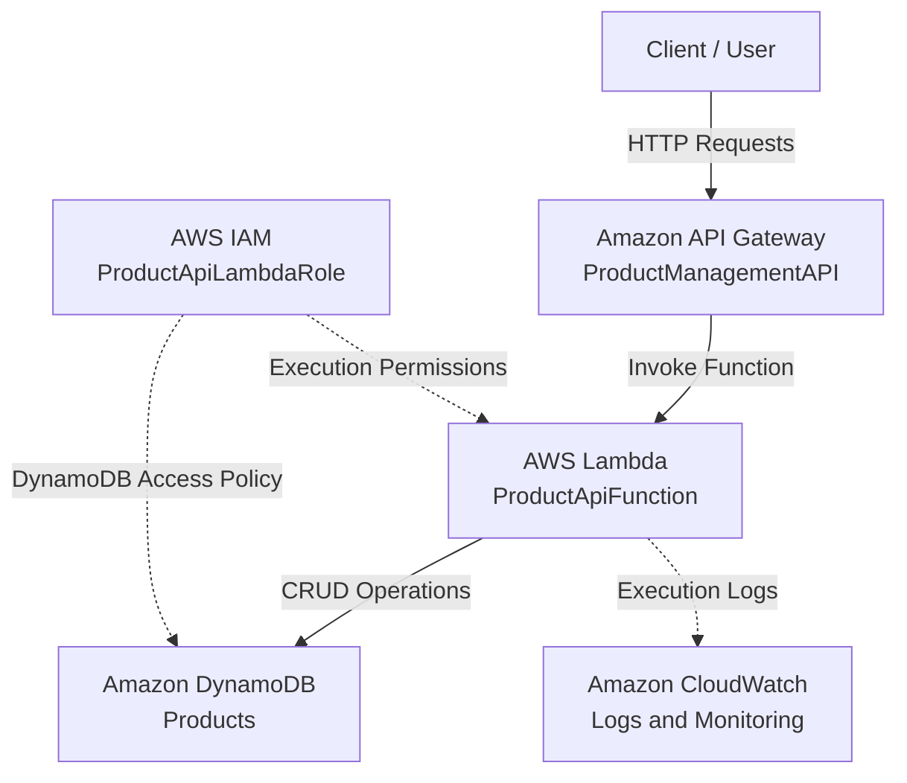

# AWS Serverless REST API – Product Management System

## Project Overview

This project demonstrates how to build a serverless REST API on AWS to manage product information using a fully serverless architecture.

The API supports the complete CRUD lifecycle:

- Create products
- Retrieve all products
- Retrieve a product by ID
- Update existing products
- Delete products

The project uses AWS managed services to build a scalable, cost-effective, and maintainable serverless application.

## Architecture

The application uses the following AWS services:

- **Amazon API Gateway:** Receives HTTP requests and routes them to the appropriate Lambda function.
- **AWS Lambda:** Executes Python backend application logic.
- **Amazon DynamoDB:** Stores product information in a NoSQL database.
- **AWS IAM:** Manages permissions and access control using least-privilege principles.
- **Amazon CloudWatch:** Collects Lambda execution logs and supports monitoring and troubleshooting.

### Architecture

### Request Flow

1. A client sends an HTTP request to Amazon API Gateway.
2. API Gateway routes the request to AWS Lambda.
3. Lambda executes Python business logic.
4. Lambda performs CRUD operations on Amazon DynamoDB.
5. CloudWatch collects Lambda execution logs.
6. IAM controls Lambda permissions and access to AWS resources.

## API Endpoints

| HTTP Method | Endpoint | Description |
|---|---|---|
| POST | `/products` | Create a new product |
| GET | `/products` | Retrieve all products |
| GET | `/products/{id}` | Retrieve a product by ID |
| PUT | `/products/{id}` | Update an existing product |
| DELETE | `/products/{id}` | Delete a product |

## Database Design

**DynamoDB Table:** `Products`

| Attribute | Type | Description |
|---|---|---|
| `product_id` | String | Partition key and unique product identifier |
| `name` | String | Product name |
| `price` | Number | Product price |
| `category` | String | Product category |
| `created_at` | String | Product creation timestamp |

DynamoDB uses `product_id` as its partition key.

## IAM Security

An IAM execution role named `ProductApiLambdaRole` was created for the Lambda function.

Permissions include:

- `AWSLambdaBasicExecutionRole` for CloudWatch logging.
- Custom DynamoDB permissions for:
  - `dynamodb:PutItem`
  - `dynamodb:GetItem`
  - `dynamodb:Scan`
  - `dynamodb:UpdateItem`
  - `dynamodb:DeleteItem`

DynamoDB permissions are restricted to the `Products` table.

## Testing Results

All five REST API operations were successfully tested using the Amazon API Gateway test feature.

| HTTP Method | Operation | Expected HTTP Status | Result |
|---|---|---|---|
| POST | Create product | 201 Created | Passed |
| GET | List all products | 200 OK | Passed |
| GET | Retrieve product by ID | 200 OK | Passed |
| PUT | Update product | 200 OK | Passed |
| DELETE | Delete product | 200 OK | Passed |

### Test Scenario

1. Created a Laptop product with a price of 1200.
2. Retrieved all products and verified the new product.
3. Retrieved the Laptop using its unique product ID.
4. Updated the Laptop price from 1200 to 1000.
5. Deleted the Laptop product.
6. Retrieved all products again and confirmed the database returned an empty product list.

All operations completed successfully.

## Monitoring

Amazon CloudWatch was used to monitor Lambda execution.

**Log Group:**

`/aws/lambda/ProductApiFunction`

Monitoring activities included:

- Checking Lambda execution logs.
- Reviewing execution events.
- Verifying successful function execution.
- Checking for application errors.

No application errors were observed during testing.

## Deployment Configuration

| Configuration | Value |
|---|---|
| AWS Region | Asia Pacific (Tokyo) |
| Region Code | `ap-northeast-1` |
| API Gateway API | `ProductManagementAPI` |
| API Gateway Stage | `dev` |
| Lambda Function | `ProductApiFunction` |
| Lambda Runtime | Python 3.12 |
| DynamoDB Table | `Products` |
| IAM Role | `ProductApiLambdaRole` |

## Project Status

**Completed — Core implementation and CRUD testing successful.**

## Key Learning Outcomes

Through this project, I gained practical experience in:

- Building REST APIs using Amazon API Gateway.
- Integrating API Gateway with AWS Lambda.
- Writing and deploying Python Lambda functions.
- Performing CRUD operations with Amazon DynamoDB.
- Configuring IAM execution roles and least-privilege permissions.
- Testing API endpoints and validating HTTP status codes.
- Monitoring Lambda executions using Amazon CloudWatch.
- Troubleshooting serverless application workflows.

## Future Improvements

Potential improvements for this project include:

- Add Amazon Cognito authentication.
- Implement API request validation.
- Add DynamoDB pagination for listing products.
- Configure API throttling and usage plans.
- Add automated testing.
- Implement infrastructure as code using AWS CloudFormation or Terraform.

## AWS Region

Asia Pacific (Tokyo) — `ap-northeast-1`
